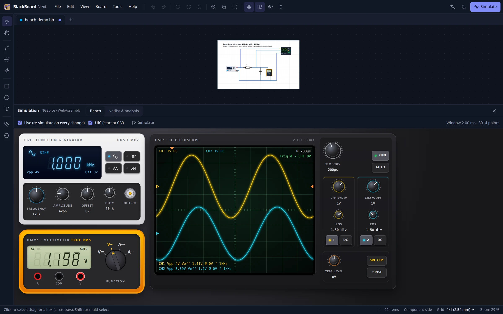
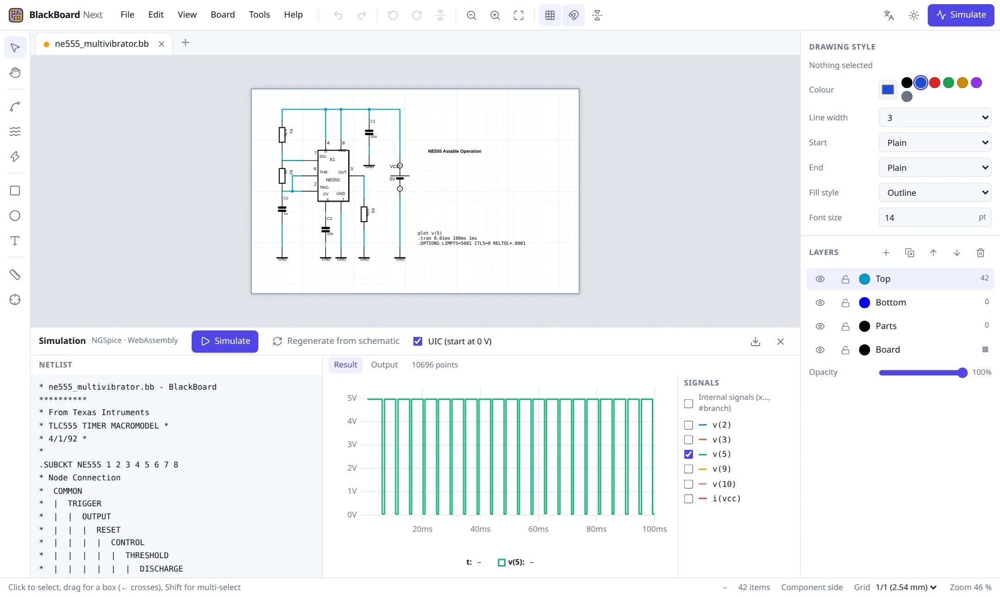

# BlackBoard Next (3.0)

A complete rewrite of the BlackBoard Circuit Designer on web technology. A single
code base runs on every platform:

| Target | How |
| --- | --- |
| **Browser** (Windows, macOS, Linux, ChromeOS, Android, iPadOS) | static files from `dist/`, any web server or file share with HTTP |
| **Installable app (PWA)**, works offline | "Install" in Chrome/Edge/Safari; `.bb` files can be opened with the app |
| **Native desktop app** (`.exe`/`.msi`, `.dmg`/`.app`, `.deb`/`.rpm`/AppImage) | [Tauri 2](https://tauri.app) shell in `src-tauri/` |

Nothing has to be installed on the target machine. No Java, no ngspice.exe and no
admin rights are needed: the simulation runs **NGSpice compiled to WebAssembly**.






## What it can do

- Perfboards (holes), stripboards (copper stripes), blank boards and schematics
- Solder side view (mirrored, copper pads, solder joints, ghosted parts)
- Part library: 383 parts with images; symbol library: 477 symbols; 177 SPICE models.
  These are converted at build time from `../parts`, `../symbols` and `../models`
- Wires/jumpers, resistors with colour bands, diodes, rectangles, ellipses/arcs, text
- Layers (visibility, lock, opacity, colour, order), multiple documents in tabs
- Select (box selection; drag right to left to select everything it crosses), move,
  rotate, flip, z-order, copy/paste, duplicate, unlimited undo/redo, snap to grid
  (1/1, 1/2, 1/4), magnetic pins, arrow keys to nudge
- Magnetic mode (Shift+M): wire ends attached to pins, wire junctions and T junctions
  follow when parts or wires are moved, rotated, flipped or nudged
- Connection check: highlights the net of a wire or pin, including the copper
  stripes of stripboards and stripe breaks
- Measure tool (mm and grid units)
- Symbol editor: combine shapes into a symbol (wire ends marked with a dot become
  pins), edit pins, break symbols apart, keep your own symbol library
- Instrument bench (Simulation → Bench): oscilloscope, multimeter and function
  generator are symbols (library category *Instruments*) that are wired like real
  instruments. Generator COM and scope GND are earthed, the multimeter floats; in the
  ammeter modes it is inserted in series. Front panels with knobs (drag, wheel, arrow
  keys), seven segment displays and a phosphor screen; live mode re-simulates after every
  edit, the transient window follows the scope time base. A ready-made demo is on the
  welcome screen and in *File → Samples*
- SPICE netlist generation (resistors, capacitors, inductors, diodes, BJTs, MOSFETs,
  DC/sine/pulse sources, subcircuits); simulation with plots (one chart per unit,
  values under the cursor, zoom by dragging, CSV export)
- File formats: **reads and writes the original `.bb` format** (zip with BoardBean XML
  and embedded parts), so files can be exchanged with BlackBoard 1.x/2.x. Export to
  PNG, SVG, SPICE (`.cir`), bill of materials (CSV), printing
- Session autosave (IndexedDB), German/English, light/dark/system theme,
  touch (pinch to zoom) and phone-size layouts

### Printed circuit boards

- **Schematic → PCB** (*PCB → Create PCB from schematic*): footprints are chosen from
  the symbols (or set per symbol in the properties panel), pins are mapped to pads
  (by name for transistors, diodes and LEDs), nets are named after GND/supply symbols,
  connected parts are placed next to each other. *Update PCB from schematic* carries
  later schematic changes over (forward annotation)
- Footprint library: 138 parametric THT and SMD footprints (KiCad-like dimensions:
  resistors, capacitors, diodes, LEDs, TO-92/TO-220/SOT, DIP/SOIC/TSSOP/QFP, headers,
  terminal blocks, crystals, switches, mounting holes …) plus every part of the classic
  part library as a through-hole footprint
- Footprint editor: pads of all shapes, pad arrays (row, DIP, zig-zag, QFP, BGA),
  silkscreen, auto courtyard, validation; own footprints are kept in the browser and
  can replace the footprint of placed parts
- Two copper layers (or single sided for home etching), silkscreen top/bottom, board
  outline with rounded corners or drawn freely (Shift+O), fit to parts, corner
  mounting holes
- Interactive routing (W): 45°/90° postures (`/` flips the bend), `V` switches the layer
  and sets a via, tracks snap to pads and never end on copper of another net; tracks
  stay attached when footprints are moved, rotated or flipped to the other side
- Copper zones (Z) with clearance, thermal reliefs, priorities and dead copper removal
- Autorouter (Shift+A): two layer maze router with rip-up & reroute, runs in the
  background; unroute all or single nets, select connected tracks (U)
- Ratsnest, net highlighting (K), cross probing between schematic and PCB
- Design rule check (Shift+D): clearance, shorts, unrouted nets, track width, drill,
  annular ring, board edge, overlapping parts — with markers on the board
- Design rules with presets for PCB manufacturers and for home etching
- Fabrication output: Gerber X2 (copper, mask, paste, silkscreen, edge cuts), Excellon
  drill files, pick & place (part centres), BOM — one zip ready for upload; 1:1
  artwork for toner transfer / UV exposure
- Layer colour view, realistic view (solder mask, HASL pads, silkscreen) and a 3D view
  (key 3) with component bodies
- **KiCad**: import `.kicad_mod` footprints (KiCad 5–8, several files at once, e.g. a
  whole `.pretty` folder) into the user library; export the user footprints as a
  `.pretty` library; export a schematic as KiCad netlist (*File → Export KiCad
  netlist*) for KiCad's PCB editor — built-in footprints are mapped to the KiCad
  standard libraries, others are written into an accompanying `BlackBoard.pretty`
- PCB data is stored inside the `.bb` archive (`bbnext/document.json`); BlackBoard
  1.x/2.x still open such files (as blank boards)

### Interactive simulation

- **Live values** (Shift+L): after every edit the DC operating point is simulated;
  wires are coloured by voltage, moving dots show the current flow, voltages and
  currents are labelled, LEDs glow. Switches are operated by clicking, push buttons
  while held, potentiometer wipers can be dragged
- **Slow motion** (Shift+T): a transient analysis is played back over a few seconds —
  blinking LEDs, charging capacitors, oscillators
- Measuring by hovering: voltage of a wire; voltage, current and power of a part; in
  slow motion with a small oscilloscope trace
- Incandescent lamps glow with their power; switches, buttons and potentiometers are
  operated directly in the schematic
- LEDs, Zener diodes and generic transistors without a SPICE model get built-in
  textbook models (LEDs by colour)
- **Simulation check**: missing ground or source, unusable values, symbols without
  SPICE type, open pins and missing models in plain words, each with a one-click fix;
  the analysis is picked in words (time response, frequency response, operating
  point) and ngspice errors are explained

### Microcontrollers

- **ATmega328P** (Arduino Uno / Nano) in the library, running real firmware in the
  live values: the [avr8js](https://github.com/wokwi/avr8js) emulator (MIT) runs in a
  web worker in real time, with ports, timers/PWM, ADC, USART, SPI, TWI and EEPROM
- Firmware is an Intel HEX file (Arduino IDE: *Sketch → Export compiled binary*) or one
  of the examples (blink, push button, running light, PWM dimmer, serial echo); it is
  stored in the schematic
- Coupled to ngspice through the operating point: outputs drive the circuit through
  their 25 Ω drivers, pull-ups are 35 kΩ, inputs read the node voltages (Schmitt
  trigger levels), A0–A5 feed the ADC, the chip resets below 2.7 V. PWM pins are
  averaged over their high and low state, so a LED dims correctly
- **ESP32** (ESP32-DevKitC V4 board, 38 pins as on the real board): the
  [esp32sim](https://github.com/mikroverk/esp32sim) emulator (MIT, Rust → WebAssembly)
  boots Espressif's mask ROM into real firmware: an Arduino sketch (Arduino IDE:
  *Export compiled binary* → `*.merged.bin`) or MicroPython with code edited in the
  app (examples: blink, push button, running light, PWM dimmer, serial echo). The
  board is powered over USB by default (GND is the reference, 5V and 3V3 are outputs)
  or through its 3.3 V regulator from the 5V pin; 40 Ω pin drivers, 45 kΩ pulls,
  ADC on the ADC1/ADC2 pins, LEDC PWM, UART0 console at 115200 baud
- Pin levels and PWM duty cycles are shown on the chip; serial monitor with input
- Limits: the coupling runs at the rate of the operating point (tens of times per
  second), so analog interplay faster than that (PWM through an RC filter back into
  the ADC) is only averaged; in the analyses of the simulation panel the pins are
  open inputs. The ESP32 runs code that keeps its CPU busy at about half real time
  (MicroPython busy-waits the last 10 ms of every `sleep_ms`, so loops should pause
  50 ms or more); Wi-Fi and Bluetooth are not part of the circuit simulation

### Schematics

- Net labels and supply symbols (VCC, +5V …) connect by name; junction dots
- Orthogonal wires (`/` flips the bend), annotate (renumber designators)
- Electrical rule check (Shift+D): open pins, duplicate designators, unreadable values,
  missing ground, parts without footprint
- Designators and values always readable, whatever the rotation

### Learning

- **Learn electronics** (F1): 16 interactive lessons from the first circuit, Ohm's law
  and voltage dividers via diodes, LEDs, Zener diodes, rectifiers and transistor
  switches to RC circuits, a 555 blinker, logic gates and your first PCB. Every task
  is checked automatically against your circuit (structure, values, simulated
  voltages and currents, routing, DRC)
- Component guide: selecting a symbol explains the component (how it works, formulas,
  typical values, common mistakes) and links to the lessons that practise it

## Development

Requirements: Node.js ≥ 23.6 (the library converter is plain TypeScript, run
natively by Node).

```bash
npm install
npm run dev        # converts the library, starts Vite on http://localhost:5173
npm test           # import/export of all sample boards, netlists, ngspice runs
npm run build      # typecheck + production build into dist/
npm run preview    # serve dist/ on http://localhost:4173
```

`npm run dev -- --host` makes the dev server reachable from other devices in the
network. Over plain http on a LAN address the browser does not allow installing the
app for offline use, and "save" falls back to downloading the file.

### ESP32 emulator

`public/esp32/` is committed, so the app builds without Rust. `scripts/build-esp32.sh`
rebuilds it: it checks out esp32sim at a pinned commit, applies `scripts/esp32sim.patch`
(WebAssembly exports for the circuit coupling, pulls of the ESP32's RTC pads), builds
the module (needs rustup) and fetches the mask ROM and MicroPython image by SHA-256.
Licences: `public/esp32/NOTICE.txt`.

### Direct links

`?lesson=<id>` starts a lesson, `?demo=pcb|bench|mcu|esp32` opens a demo,
`?sample=schematics/<file>.bb` a sample, `?view=3d|realistic|live|slowmo` adds a view —
e.g. `…/?lesson=led-resistor` or `…/?demo=pcb&view=3d`.

### Docker

The image builds the app and serves it with nginx (unprivileged, port 8080). The
build needs the library in the repository root, so the build context is the root:

```bash
docker build -f blackboard-next/Dockerfile -t blackboard-next .   # in the repository root
docker run -d -p 8080:8080 blackboard-next
```

or, from `blackboard-next/`, `docker compose up -d --build` (publishes on
`127.0.0.1:8080` for a reverse proxy on the same host).

The app only uses relative URLs, so it also runs below a path prefix. Example for
Caddy serving it at `https://example.org/blackboard/`:

```caddy
example.org {
	redir /blackboard /blackboard/ 308
	handle_path /blackboard/* {
		encode zstd gzip
		reverse_proxy 127.0.0.1:8080
	}
	# … the rest of the site
}
```

`handle_path` strips the prefix before proxying. Hashed assets are cached for a
year, `index.html` and the service worker are always revalidated, so a new image
reaches users on their next visit.

`scripts/deploy.sh` builds the image, copies it to a server over SSH and restarts
the container there (`DEPLOY_HOST`, default `root@pueski.de`; `DEPLOY_PORT`, default
`8210`; `DEPLOY_DIR`, default `/opt/blackboard`). The live instance runs at
https://pueski.de/blackboard/.

### Desktop app (Tauri)

Additionally requires Rust (`rustup`) and the
[platform prerequisites](https://tauri.app/start/prerequisites/)
(WebView2 on Windows, Xcode tools on macOS, `webkit2gtk-4.1` on Linux).

```bash
npm run tauri dev     # native window with hot reload
npm run tauri build   # installers in src-tauri/target/release/bundle/
```

## Architecture

```
scripts/build-library.ts   parts/symbols/models/samples (XML) -> public/library/*.json
src/io/                    XML reader/writer, legacy BoardBean format, .bb archives, KiCad
src/model/                 document model, item operations, engineering values
src/geometry/              transforms, bounds, hit testing, pin positions
src/render/                SVG rendering of boards, parts, symbols, resistors, diodes
src/editor/                canvas interaction, commands & shortcuts, file actions
src/spice/                 connectivity (union-find), netlist, ngspice web worker, live values
src/mcu/                   ATmega328P on avr8js, ESP32 on esp32sim (web workers), firmware
                           formats, examples, coupling to the operating point
public/esp32/              esp32sim.wasm, ESP32 mask ROM, MicroPython (scripts/build-esp32.sh)
src/pcb/                   PCB: footprints, copper geometry, connectivity, ratsnest, DRC,
                           zones, schematic -> PCB, autorouter, fabrication outputs (fab/)
src/pcb3d/                 3D board viewer (three.js, loaded on demand)
src/learn/                 lessons, checks, component guide
src/store/                 zustand store with immer-based undo history
src/ui/                    panels, menus, dialogs, simulation panel (uPlot)
src/platform/              file access (Tauri / File System Access API / download), IndexedDB
src-tauri/                 native shell (dialogs + file system plugins)
```

Coordinates are the original board units: 16 units = 0.1" = 2.54 mm, so all
existing boards, parts and symbols fit without conversion. Net numbering follows
BlackBoard 1.x so `plot v(5)` in existing schematics still shows the same signal.

## Notes

- Newer ngspice versions sometimes settle oscillators into a static operating point.
  Transient analyses therefore start from 0 V (`uic`) by default; if that does not
  converge the simulation is repeated automatically from the DC operating point.
- `samples/schematics/phasenschieber.bbs` is a damaged archive and is not shipped.
- The NGSpice engine (~20 MB) is loaded on the first simulation and cached for
  offline use.

Licence: GPL-2.0 (like BlackBoard). The part library is partly CC BY 3.0
(Gerd Bartelt). Simulation: ngspice (BSD-3) via eecircuit-engine (MIT).
